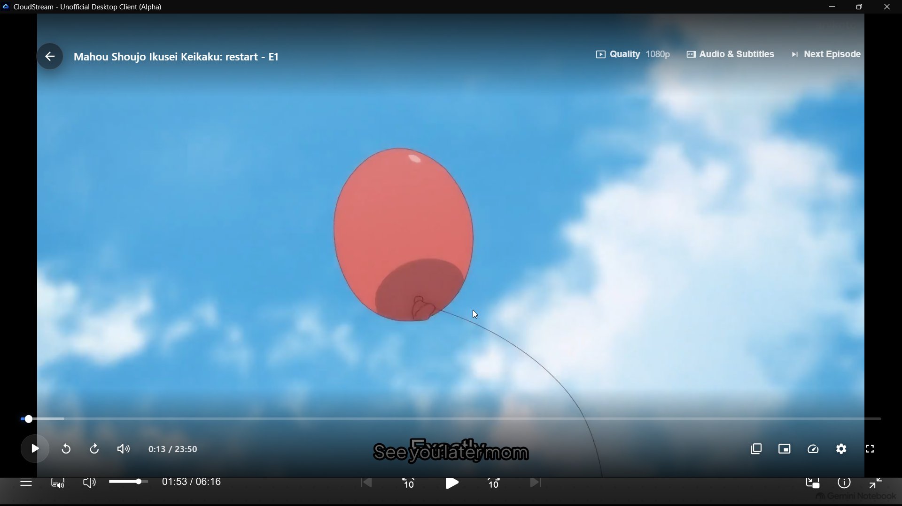
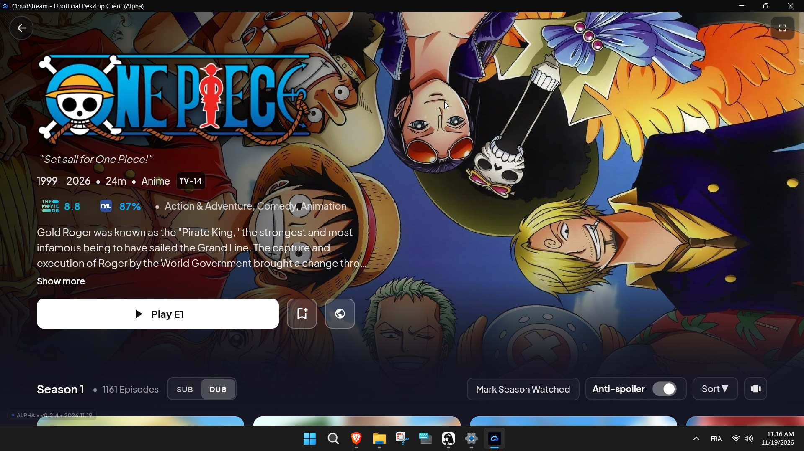
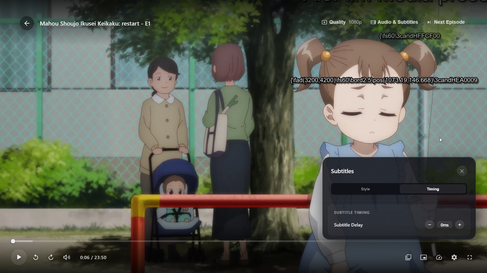

# CloudStream Desktop (unofficial, alpha)

Windows desktop port of [CloudStream 3](https://github.com/recloudstream/cloudstream) — the Android
streaming client — rebuilt as a native Kotlin / Compose Multiplatform application.

Status: **alpha, v0.2.4** · Windows 10/11 x64 · portable, no installer, no Java install required.

| Player | Title page | Subtitles |
|---|---|---|
|  |  |  |

## Download

Grab the portable build from [Releases](../../releases):

```
CloudStream-Portable-0.2.4-windows-x64.zip   (~234 MB)
```

1. Extract the zip anywhere (USB stick works).
2. Run `CloudStream-Desktop.exe`.
3. Done — the bundled runtime, `libmpv` and all libraries ship inside the folder.

Verify the download against [`SHA256SUMS.txt`](SHA256SUMS.txt):

```powershell
Get-FileHash .\CloudStream-Portable-0.2.4-windows-x64.zip -Algorithm SHA256
```

## Portable by design

A `portable.txt` sits next to the executable, so **everything** stays inside the folder in
`CloudStreamData/`: extensions, watch history, downloads, caches, logs. Delete the folder and the app
leaves no trace on the machine.

## First run: it ships empty on purpose

Like upstream CloudStream, this build contains **no video sources**. You have to add extension
repositories:

1. Settings → Extensions → Add repository
2. Paste a CloudStream extension repo URL
3. Install the providers you want, then search.

Extensions are loaded from Android plugin APKs — the desktop build parses and runs them itself.

## What works (v0.2.4)

- Native desktop window, dark TV-style UI, keyboard + mouse
- Playback through bundled `libmpv` — quality selection, audio/subtitle tracks, subtitle delay
  (Style / Timing tabs), speed, PiP, fullscreen
- CloudStream extension APKs and repositories
- Rich title pages: posters, TMDB + MAL ratings, synopsis, seasons/episodes, SUB/DUB, anti-spoiler,
  mark season watched, grid/list episode layout
- Local library, watch progress, downloads folder

## Known limitations

- Alpha: expect rough edges, especially around some extension providers and DRM-protected sources.
- Windows x64 only — no macOS/Linux build here.
- Some styled ASS subtitles render their raw override tags in the subtitle panel.
- No auto-updater; re-download a newer zip.

## Licence and source

This is an unofficial port of CloudStream, which is licensed **GPL-3.0**. The binaries here are
derived from that project; upstream source lives at
[recloudstream/cloudstream](https://github.com/recloudstream/cloudstream). Bundled third-party
components keep their own licences, all present inside the extracted folder (`runtime/legal`,
`app/resources`).

Not affiliated with recloudstream. No content is hosted or distributed by this repository.
